# Implementation Strategy
# Contrastive Speech Analytics & Temporal Flaw Grounding

**Version**: 1.0  
**Date**: October 12, 2026  
**Status**: Draft — Awaiting Approval

> Implementation update (2026-10-12): the local FastAPI dashboard and core are runnable. The optional Next.js shell is not build-verified. Reviewed real speeches and optional WhisperX inference remain open. See `docs/task.md`, `docs/TECHNICAL_REPORT.md`, and `docs/CODE_REVIEW_GUIDE.md` for the actual implementation. The detailed architecture below retains the original plan.

> Real recordings could not be downloaded through the configured network proxy. Controlled harmonic fixtures were used to test the software, and they are not a substitute for the required five real speeches. The implementation order progressed with explicit fixture provenance while real-data work remains pending.

---

## 1. Strategy Overview

We follow a **bottom-up, data-first** approach:

1. **Phase 1**: Build the contrastive dataset (the foundation everything depends on)
2. **Phase 2**: Build the audio processing pipeline (feature extraction + alignment)
3. **Phase 3**: Build the flaw detection & scoring engine
4. **Phase 4**: Build the interactive dashboard
5. **Phase 5**: Integration, polish, documentation, and demo video

> **Why this order?** Each phase feeds into the next. You can't detect flaws without features. You can't extract features without audio. You can't demo without a dashboard. Data-first ensures we have real signals to work with at every step.

---

## 2. Phase Breakdown

### Phase 1: Contrastive Dataset Construction
**Duration**: ~3-4 hours  
**Goal**: Create ≥5 paired speech samples with "ideal" + "flawed" variants

#### Step 1.1 — Source Ideal Speeches
- **Sources**: TED talks, famous political speeches, competitive debate recordings
- **Method**: Download audio from YouTube/public sources using `yt-dlp`
- **Format**: Convert to WAV, 16kHz, mono
- **Minimum**: 5 speeches, 30-120 seconds each

#### Step 1.2 — Transcribe Ideal Speeches
- **Tool**: OpenAI Whisper (large-v3) for accurate transcription
- **Output**: `transcript.txt` per speech
- **Verification**: Manual spot-check for accuracy

#### Step 1.3 — Generate Flawed Versions
- **Method**: Use `edge-tts` (Microsoft's free TTS) to re-synthesize the transcripts
- **Flaw injection techniques**:
  - **Monotone**: TTS with flat pitch (SSML `<prosody pitch="medium">`)
  - **Too fast**: TTS with `<prosody rate="fast">` or `rate="+50%"`
  - **Too slow**: TTS with `<prosody rate="slow">` or `rate="-40%"`
  - **Wrong pauses**: Remove natural pauses or add random ones using pydub
  - **Volume issues**: Programmatically alter volume at random segments
- **Gradient**: 3 levels per speech:
  - Level 1: Egregiously bad (multiple severe flaws)
  - Level 2: Moderately bad (1-2 noticeable flaws)
  - Level 3: Almost perfect (subtle deviations)

#### Step 1.4 — Force-Align & Label
- **Tool**: WhisperX for word-level forced alignment on all variants
- **Output**: `alignment.json` + `flaw_labels.json` per variant
- **Labels**: Manually review and annotate flaw boundaries

### Phase 2: Audio Processing Pipeline
**Duration**: ~3-4 hours  
**Goal**: Build Python modules for feature extraction and alignment

#### Step 2.1 — Project Setup
```bash
mkdir -p backend/{core,api,models}
pip install fastapi uvicorn librosa whisperx scipy numpy soundfile pydub
```

#### Step 2.2 — Feature Extraction Module (`backend/core/features.py`)
Functions to implement:
- `extract_mfcc(audio, sr)` — 13 MFCC coefficients
- `extract_f0(audio, sr)` — Fundamental frequency via pYIN
- `extract_energy(audio, sr)` — RMS energy contour
- `extract_speech_rate(alignment, window_size)` — Syllables/second
- `detect_pauses(audio, sr, threshold)` — Silent intervals
- `extract_spectral_features(audio, sr)` — Spectral centroid, rolloff
- `normalize_features(features)` — Speaker-agnostic z-normalization

#### Step 2.3 — Forced Alignment Module (`backend/core/alignment.py`)
- `align_transcript(audio_path, transcript_text)` — WhisperX alignment
- `segment_by_sentences(alignment)` — Group words into sentence segments
- `time_align_features(baseline_align, participant_align)` — Map features to common time axis

#### Step 2.4 — Unit Tests
- Test each extraction function on a known audio file
- Verify output shapes, value ranges, NaN handling

### Phase 3: Flaw Detection & Scoring Engine
**Duration**: ~3-4 hours  
**Goal**: Detect deviations, classify flaws, generate causal explanations

#### Step 3.1 — Deviation Detection (`backend/core/detector.py`)
- Compare participant vs. baseline features per aligned time segment
- Z-score computation with configurable thresholds
- Contiguous region detection (merge nearby flaws)
- Multi-feature fusion (pitch + energy + rate combined signal)

#### Step 3.2 — Flaw Classification (`backend/core/classifier.py`)
- Rule-based classification from feature deltas to flaw types:
  - High speech rate z-score → "pacing_too_fast"
  - Low F0 variance → "pitch_monotone"
  - Missing expected pause → "pause_missing"
  - Energy drop → "volume_too_quiet"
  - etc.

#### Step 3.3 — Rubric Scoring (`backend/core/scorer.py`)
- 5 dimensions: Vocal Tone, Pacing/Rhythm, Volume Dynamics, Pause Usage, Vocal Clarity
- Score 1-10 per dimension based on deviation severity and frequency
- Overall composite score (weighted average)

#### Step 3.4 — Causal Explanation Generator (`backend/core/explainer.py`)
- Template-based explanation generation
- Include: summary, mathematical detail, actionable recommendation
- Map raw z-scores to human-readable language

### Phase 4: Interactive Dashboard
**Duration**: ~4-5 hours  
**Goal**: Build a polished web frontend for upload + visualization

#### Step 4.1 — Next.js Project Setup
```bash
npx -y create-next-app@latest ./ --js --no-tailwind --no-eslint --app --src-dir --no-turbopack
npm install wavesurfer.js chart.js react-chartjs-2
```

#### Step 4.2 — Upload Page
- Drag-and-drop audio upload zone
- Optional transcript text area
- Baseline speech selector (dropdown)
- "Analyze" button with loading state

#### Step 4.3 — Analysis Dashboard
- **Waveform Viewer**: WaveSurfer.js with highlighted flaw regions
- **Score Overview**: Animated overall score + radar chart for rubric scores
- **Feature Comparison Charts**: Line charts overlaying baseline vs. participant for F0, energy, speech rate
- **Flaw Cards**: Scrollable cards for each detected flaw with:
  - Timestamp range
  - Flaw type badge
  - Severity indicator
  - Causal explanation (summary + math + recommendation)
  - "Play this section" button
- **Transcript View**: Full transcript with words highlighted by severity

#### Step 4.4 — Visual Polish
- Dark theme with glassmorphism
- Smooth transitions and micro-animations
- Premium typography (Inter/Outfit from Google Fonts)
- Responsive layout (desktop-first, tablet-friendly)

### Phase 5: Integration, Testing & Deliverables
**Duration**: ~2-3 hours  
**Goal**: Wire everything together, test, document, prepare submission

#### Step 5.1 — API Integration
- Connect frontend upload → backend `/api/analyze`
- Handle loading states, errors, progress indication

#### Step 5.2 — End-to-End Testing
- Upload a known flawed speech → verify correct flaw detection
- Run 3 identical analyses → verify reproducibility
- Test edge cases (short audio, silence, noise)

#### Step 5.3 — Documentation
- README.md with setup, usage, and architecture overview
- Technical documentation (max 6 pages) covering:
  - Dataset construction methodology
  - Feature extraction approach
  - Scoring rubric design
  - Model architecture
- Inline code comments

#### Step 5.4 — Docker Setup
- `Dockerfile` for backend
- `Dockerfile` for frontend
- `docker-compose.yml` for one-command startup

#### Step 5.5 — Demo Video Prep
- Script the 3-10 minute demo narrative
- Show: dataset, stress testing, dashboard catching flaws
- Record with OBS or similar

---

## 3. Risk Mitigation

| Risk | Probability | Impact | Mitigation |
|---|---|---|---|
| WhisperX forced alignment fails on certain audio | Medium | High | Fallback to Whisper timestamps; have backup alignment with gentle |
| TTS-generated flawed speech sounds too artificial | Medium | Medium | Supplement with programmatic audio manipulation (pitch shift, speed change) on real audio |
| Feature extraction too slow for real-time feel | Low | Medium | Pre-compute baseline features; only compute participant features on upload |
| Dashboard visualization is too plain | Low | High | Allocate extra time for CSS polish; use glassmorphism, animations |
| Dataset too small for convincing demo | Medium | Medium | Focus on quality over quantity; 5 well-crafted pairs > 20 sloppy ones |

---

## 4. Dependency Chain

```mermaid
graph LR
    A[Source Ideal Speeches] --> B[Transcribe]
    B --> C[Generate Flawed Versions]
    C --> D[Force-Align All Variants]
    D --> E[Label Flaw Regions]
    E --> F[Feature Extraction Pipeline]
    F --> G[Flaw Detection Engine]
    G --> H[Scoring & Explanations]
    H --> I[Dashboard Frontend]
    I --> J[Integration & Testing]
    J --> K[Docker + Docs + Video]
```



---

## 5. Critical Path

The **critical path** (longest chain of dependent tasks) is:

**Source speeches → Transcribe → Generate flawed versions → Force-align → Build feature extraction → Build flaw detection → Build dashboard → Integrate**

Every phase depends on the previous one completing. This means:
- **No parallelism in the core pipeline** (Phase 1 → 2 → 3 → 4)
- **Documentation and Docker can be parallelized** with Phase 4 and 5
- **Frontend skeleton can be built in parallel** with Phase 2-3 (using mock data), then wired up

---

## 6. Parallel Work Opportunities

| Can run in parallel | Depends on |
|---|---|
| Frontend skeleton + mock UI | Nothing (start immediately) |
| Docker setup | Nothing (start after Phase 1) |
| Documentation writing | Can start after Phase 2 |
| Feature extraction development | Phase 1 completion |
| Flaw detection development | Phase 2 completion |
| Dashboard data wiring | Phase 3 + 4 completion |
